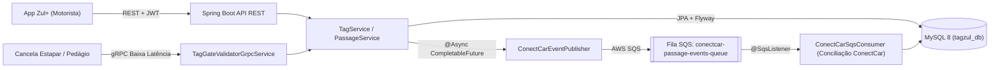

# PoC Estapar — Pagamento Automático Tag Zul+ & ConectCar

Prova de Conceito (PoC) de portfólio simulando a arquitetura backend da solução **Tag Zul+** da **Estapar**, voltada ao pagamento automático em **estacionamentos** e **praças de pedágio** com conciliação assíncrona integrada à rede **ConectCar**.

---

## Tecnologias e Boas Práticas Aplicadas

| Categoria | Tecnologia / Prática | Onde é aplicada no projeto |
|---|---|---|
| **Linguagem & Framework** | **Java 21** + **Spring Boot 3.3** | Records para DTOs/Eventos, Domínio Rico, Injeção por Construtor |
| **APIs REST & Erros** | **Spring Web** + **Bean Validation** + **RFC 7807 (`ProblemDetail`)** | `AuthController`, `TagController`, `PassageController`, `GlobalExceptionHandler` |
| **Banco de Dados & SQL** | **MySQL 8** + **Spring Data JPA** + **Flyway** | `V1__init_schema.sql` com índices de performance e `ddl-auto: validate` |
| **Segurança** | **Spring Security 6** + **OAuth2 Resource Server / JWT (HMAC-SHA256)** | `SecurityConfig`, `JwtTokenService` (Stateless Bearer Token) |
| **Baixa Latência (Cancelas)** | **gRPC** + **Protocol Buffers (Protobuf)** | `tag_gate_validator.proto`, `TagGateValidatorGrpcService` |
| **Assincronismo & AWS** | **`@Async` / `CompletableFuture`** + **AWS SQS (Spring Cloud AWS 3)** | `ConectCarEventPublisher`, `ConectCarSqsConsumer` |
| **Testes Unitários** | **JUnit 5** + **Mockito** | `TagTest`, `AuthServiceTest`, `TagServiceTest`, `PassageServiceTest` |
| **Testes de Integração BDD** | **Cucumber 7 (Gherkin PT-BR)** + **SpringBootTest** | `tag_zul_passage.feature`, `TagZulPassageSteps`, `CucumberIntegrationTest` |

---

## Arquitetura da Solução



### Fluxo de Negócio
1. **Cadastro e Autenticação (`/api/v1/auth`)**: O motorista se cadastra e recebe um **Token JWT (OAuth2 Bearer)** assinado via HMAC-SHA256.
2. **Ativação e Recarga da Tag Zul+ (`/api/v1/tags`)**: O motorista vincula o código da Tag (`tagCode`) à placa do veículo (`licensePlate`) e realiza recargas de saldo (`BigDecimal`).
3. **Passagem na Cancela (REST `/api/v1/passages` ou gRPC `ValidateAndAuthorizeGate`)**:
   - A cancela consulta a Tag em tempo real.
   - Se a Tag estiver `ACTIVE` e com saldo suficiente, o débito é efetuado imediatamente e a cancela é aberta.
   - A transação nasce com status `PENDING_CONECTCAR_SYNC` e dispara em background (`@Async` + **AWS SQS**) o evento de conciliação para a **ConectCar**, sem bloquear a passagem do veículo.

---

## Endpoints Principais (API REST)

| Método | Endpoint | Autenticação | Descrição |
|---|---|---|---|
| `POST` | `/api/v1/auth/register` | Pública | Cadastra cliente e retorna Token JWT |
| `POST` | `/api/v1/auth/login` | Pública | Autentica cliente e retorna Token JWT |
| `POST` | `/api/v1/tags` | `Bearer <JWT>` | Ativa uma nova Tag Zul+ vinculada à placa |
| `GET` | `/api/v1/tags/{tagCode}` | `Bearer <JWT>` | Consulta saldo e status da Tag Zul+ |
| `POST` | `/api/v1/tags/{tagCode}/recharge` | `Bearer <JWT>` | Realiza recarga de saldo na Tag |
| `PATCH` | `/api/v1/tags/{tagCode}/block` | `Bearer <JWT>` | Bloqueia preventivamente a Tag |
| `POST` | `/api/v1/passages` | `Bearer <JWT>` | Registra passagem (`PARKING` ou `TOLL`) |
| `GET` | `/api/v1/passages/tag/{tagCode}` | `Bearer <JWT>` | Lista o extrato de passagens da Tag |

---

## Como Executar os Testes (Unitários + BDD Cucumber)

Para compilar os contratos `.proto` do gRPC e executar todos os testes unitários (**JUnit 5 / Mockito**) e de integração BDD (**Cucumber**):

```bash
mvn clean test
```
